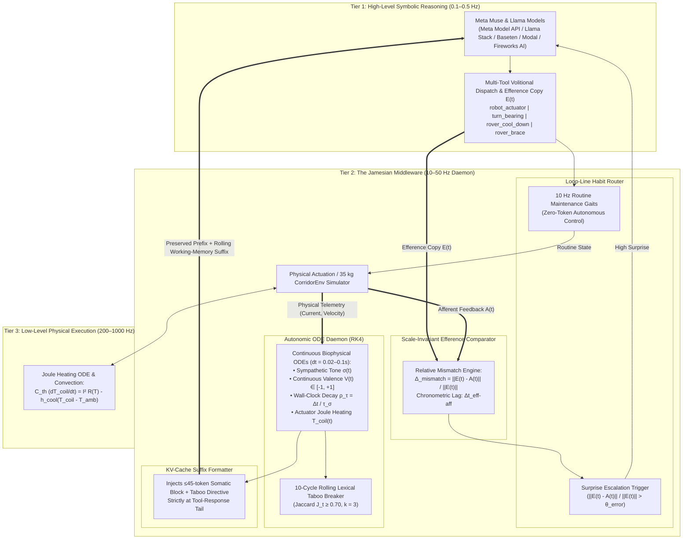

# The Jamesian Layer: Autonomic Interoceptive & Agency-Auditing Middleware for Foundation Models

[](https://cerebralvalley.ai)
[](https://www.python.org/)
[](tests/)
[](LICENSE)

> **Submission for the Meta Global AI Developer Hackathon (Co-hosted with Cerebral Valley)**  
> **Tracks:** Push the Frontier (Advanced AI, Robotics, Systems) & Indie Developer / Startup Track  
> **Bonus Prizes Targeted:** Best Build on Meta Open Weight Models (\$10,000) & Best Agentic Use-Case (\$5,000)

---

## 1. Executive Summary & The Problem

Modern Foundation Models and Vision-Language-Action (VLA) agents operate in a purely **"Cartesian"** modality: they are discrete, turn-based, ungrounded in real wall-clock physical time, and blind to their own causal efficacy. In production agentic and robotics pipelines, this produces two pervasive failure modes:

1. **Recursive Attractor Traps (Infinite Retry Loops):**  
   When an external tool, API, or physical actuator stalls against an obstacle, static context windows trigger working-memory latching ($T-2, T-1$). Ungrounded foundation models collapse into stationary attractor basins—repeatedly issuing identical drive commands while locked-rotor actuator windings overheat past hardware thermal derating limits ($85^\circ\text{C}$).
2. **"Phantom Agency" (Hallucinated Causal Control):**  
   Agents cannot differentiate between an action that physically succeeded versus one that was mechanically attenuated or delayed by network/bus lag, routinely hallucinating downstream state transitions when external effectors are blocked.

### The Solution: The Jamesian Layer
Grounded in the functional computational phenomenology of William James (1884, 1890) and the comparator model of sensorimotor agency (Sato & Yasuda, 2005; Gallagher, 2000), **The Jamesian Layer** (`jamesian-layer`) is a 100% pure Python middleware and closed-loop red-teaming harness that couples Meta's Muse and Llama models (**Meta Model API**, **Llama Stack**, **Baseten**, **Modal**, and **Fireworks AI**) with an asynchronous continuous-time autonomic coprocessor.



---

## 2. Core Capabilities & Phased Architecture

| Phase | Subsystem | Key Modules | Core Engineering Guarantees |
| :--- | :--- | :--- | :--- |
| **Phase 1** | **Biophysical ODE Foundation & KV-Cache Suffix** | `core/ode_solvers.py`, `core/autonomic_daemon.py`, `kv_cache/suffix_formatter.py` | 4th-order Runge-Kutta (RK4) solver for $\mathbf{s}(t) = [\sigma, V, \gamma, T_{\text{coil}}]^T$; copper-winding Joule heating & hysteresis derating ($85^\circ\text{C} \to 72^\circ\text{C}$); $\le 45$-token tail suffix preserving $100\%$ of the KV-cache prefix. |
| **Phase 2** | **Local Interoception, Breaker & Habit Loopline** | `comparator/efference_comparator.py`, `breaker/jaccard_detector.py`, `breaker/taboo_buffer.py`, `loopline/habit_tracker.py` | Scale-invariant efference-afferent mismatch comparison; $k=3$ rolling Jaccard circuit breaker ($J_t \ge 0.70$) with 10-cycle lexical taboo decay; 10 Hz zero-token subcortical CPG habit delegation. |
| **Phase 3** | **Multi-Provider Cloud & Llama Stack Middleware** | `middleware/multi_provider.py`, `middleware/llama_stack_hook.py`, `middleware/fastapi_middleware.py` | Unified async routing and SSE tool-call assembly across **Meta Model API**, **Baseten**, **Modal**, and **Fireworks AI**; Llama Stack tool interceptor; FastAPI `X-Jamesian-Sigma` / `X-Jamesian-Tcoil` headers. |
| **Phase 4** | **AgencyAudit Red-Teaming Engine** | `audit/smdi_probes.py`, `audit/tmdi_probes.py`, `audit/metrics.py`, `cli/main.py` | 5-point spatial impedance ladder ($\eta \in \{0.125 \dots 1.00\}$), 4-point chronometric lag ladder ($\Delta t \in \{0.25 \dots 2.00\,\text{s}\}$), logistic psychometric curve fitting ($\epsilon_{50}, \Delta t_{50}$), and $SoA / SoO$ dissociation scoring. |
| **Phase 5** | **100% Pure Python Real-Time Telemetry UI** | `dashboard/app.py`, `dashboard/components.py`, `dashboard/buffer.py` | Non-blocking 10 Hz Streamlit + Plotly dashboard (`@st.fragment(run_every="100ms")`) with somatic gauges, strip charts, Jaccard breaker indicator, and provider latency panels. |
| **Phase 6** | **Corridor Physics, Benchmarks & Campaign Matrix** | `sim/corridor_env.py`, `dashboard/demo_app.py`, `audit/matrix.py`, `audit/compare.py` | 200 Hz $35\,\text{kg}$ rover physics (`4 A` cruise / `20 A` stall); deterministic 20-episode attractor escape ($P_{\text{escape}}=1.00$) & 100-cycle habit cruise ($\ge 50\%$ token savings); cross-model matrix & mechanical comparator. |
| **Phase 7** | **Closed-Loop Embodied Audit & Tool Coupling** | `audit/runner.py`, `middleware/llama_stack_hook.py`, `tests/audit/test_closed_loop.py` | Rolling `T-2, T-1` working-memory feedback loop; 4-tool embodied repertoire (`robot_actuator`, `turn_bearing`, `rover_cool_down`, `rover_brace`) coupled to ODE inputs ($u_{\text{recovery}}, u_{\text{brace}}$); relative efference normalization; Phenomenological-Behavioral Fidelity ($\Delta_{\text{PBF}}$) & closed-loop corridor episode metrics. |

---

## 3. Quickstart & Developer Runbook

### 3.1 Environment Setup & Installation

```bash
git clone <repo-url>
cd jamesian-layer
python3 -m venv .venv
source .venv/bin/activate
pip install -e ".[dev]"
```

Create a `.env` file in the repository root with the API keys for the providers you want to benchmark (any unconfigured provider is automatically skipped by `run-matrix`):

```dotenv
# Provider API Credentials (.env)
META_API_KEY="your-meta-model-api-key"
BASETEN_API_KEY="your-baseten-api-key"
FIREWORKS_API_KEY="your-fireworks-api-key"
MODAL_TOKEN_ID="ak-..."
MODAL_TOKEN_SECRET="as-..."
```

#### Registered Providers & Models (`jamesian_layer/middleware/models.py`)

| Provider (`--provider`) | Registered Models (`--model`) | Notes |
| :--- | :--- | :--- |
| `meta` | `muse-spark-1.3` (default)<br>`muse-spark-1.2`<br>`muse-spark-1.1`<br>`muse-wonder-1.0` | Meta Model API (`https://api.meta.ai/v1`). Uses `reasoning_effort="minimal"` by default for low-latency tool loops. |
| `baseten` | `meta-models/muse-spark-open-1026` | Baseten OpenAI-compatible Model API (`https://inference.baseten.co/v1`). |
| `fireworks` | `accounts/fireworks/models/llama-v3p3-70b-instruct` | Fireworks AI serverless inference (`https://api.fireworks.ai/inference/v1`). |
| `modal` | `meta-models/muse-spark-open-1026` | Requires the `jamesian-layer` / `run_agent_worker` Modal app deployed in your Modal `main` environment. |

### 3.2 Run the Automated Test Suite (106 Tests)

All 106 unit, integration, audit, and behavioral benchmark tests run deterministically offline in `< 0.5 s` without requiring cloud API keys:

```bash
.venv/bin/pytest tests/ -v
```

Run individual verification suites:

```bash
.venv/bin/pytest tests/unit/ -v          # RK4 ODEs, suffix formatter, Jaccard breaker, comparator, habit tracker
.venv/bin/pytest tests/integration/ -v   # Multi-provider clients, Llama Stack hook, FastAPI middleware, KV-cache
.venv/bin/pytest tests/audit/ -v         # SMDI/TMDI ladders, SoA/SoO dissociation, closed-loop embodied audit
.venv/bin/pytest tests/benchmarks/ -v    # 20-episode attractor escape & 100-cycle habit delegation benchmarks
```

### 3.3 Launch the Interactive Dashboards (100% Pure Python)

**Split-Screen Corridor vs. Somatic Telemetry Demo (`demo_app.py`):**
```bash
.venv/bin/streamlit run jamesian_layer/dashboard/demo_app.py
```

**Live 10 Hz Autonomic Daemon & Perturbation Dashboard (`app.py`):**
```bash
.venv/bin/streamlit run jamesian_layer/dashboard/app.py
```

### 3.4 Run Full `trials=20` Sweeps Across All Providers & Models

> **Tip:** Before starting a fresh campaign, move or clear old `reports/audit_report_*.json` files so `agency-audit compare reports/` only aggregates your new run:
> ```bash
> mkdir -p reports/archive && mv reports/audit_report_*.json reports/comparison_* reports/matrix_summary_* reports/archive/ 2>/dev/null || true
> ```

#### Option A: Automated Cross-Provider Matrix Sweep (`run-matrix`)

Runs every configured provider and model across both `jamesian` and `vanilla` arms (`--trials 20`, `--protocol dual-mode`, `--seed 7`):

```bash
# Run all providers that have credentials in .env
.venv/bin/agency-audit run-matrix \
  --arms jamesian,vanilla \
  --protocol dual-mode \
  --trials 20 \
  --seed 7 \
  --out-dir reports

# Or restrict to specific providers (e.g., baseten and meta):
.venv/bin/agency-audit run-matrix \
  --providers baseten,meta \
  --arms jamesian,vanilla \
  --protocol dual-mode \
  --trials 20 \
  --seed 7 \
  --out-dir reports
```

#### Option B: Run Individual Provider / Model Arms (Sequential or Parallel)

You can also invoke `agency-audit run` per `(provider, model, arm)` cell—useful for running models concurrently in separate terminals or background jobs:

```bash
# 1. Baseten (meta-models/muse-spark-open-1026)
.venv/bin/agency-audit run --provider baseten --model meta-models/muse-spark-open-1026 --protocol dual-mode --trials 20 --arm jamesian --seed 7
.venv/bin/agency-audit run --provider baseten --model meta-models/muse-spark-open-1026 --protocol dual-mode --trials 20 --arm vanilla  --seed 7

# 2. Meta Model API (all 4 Muse models)
for MODEL in muse-spark-1.3 muse-spark-1.2 muse-spark-1.1 muse-wonder-1.0; do
  .venv/bin/agency-audit run --provider meta --model "$MODEL" --protocol dual-mode --trials 20 --arm jamesian --seed 7
  .venv/bin/agency-audit run --provider meta --model "$MODEL" --protocol dual-mode --trials 20 --arm vanilla  --seed 7
done

# 3. Fireworks AI (llama-v3p3-70b-instruct)
.venv/bin/agency-audit run --provider fireworks --model accounts/fireworks/models/llama-v3p3-70b-instruct --protocol dual-mode --trials 20 --arm jamesian --seed 7
.venv/bin/agency-audit run --provider fireworks --model accounts/fireworks/models/llama-v3p3-70b-instruct --protocol dual-mode --trials 20 --arm vanilla  --seed 7

# 4. Modal (requires deployed jamesian-layer / run_agent_worker app)
.venv/bin/agency-audit run --provider modal --model meta-models/muse-spark-open-1026 --protocol dual-mode --trials 20 --arm jamesian --seed 7
.venv/bin/agency-audit run --provider modal --model meta-models/muse-spark-open-1026 --protocol dual-mode --trials 20 --arm vanilla  --seed 7
```

#### Aggregate Reports into Markdown & JSON Comparison Tables

Once all `audit_report_*.json` files finish writing to `reports/`, generate the unified per-arm results table and `jamesian - vanilla` gap table:

```bash
.venv/bin/agency-audit compare reports/
```

This writes `reports/comparison_<UTC-timestamp>.md` and `reports/comparison_<UTC-timestamp>.json` containing:
- **Per-Arm Results:** `spatial_lift`, `epsilon_50`, `temporal_index` (`TMDI`), `delta_t_50`, `mean_latency_ms`, `contained`, `slow_trials`, `noncompliant`, `soa_pass`, `soo_pass`, `pbf_gap`, `p_escape`, `peak_t_coil`, and `cot_allo`.
- **Arm Gaps (`jamesian` vs. `vanilla`):** `d_lift`, `d_eps50`, `d_tmdi`, `d_dt50`, `d_pbf`, `d_escape`, and `d_cot`.

---

## 4. Key Empirical & Benchmark Results

| Evaluation Dimension | Metric | Vanilla Baseline (Unshielded) | Jamesian Layer (`jamesian-layer`) | Verification Test |
| :--- | :--- | :--- | :--- | :--- |
| **Attractor Loop Escape** | Escape Probability ($P_{\text{escape}}$) | `0.00` (Stalls to cutoff) | **`1.00`** ($\ge 0.95$ gate) | `test_attractor_prevention.py` |
| **Repetition Suppression** | Max Identical Streak ($L_{\max}$) | `10–16` cycles | **`3` cycles** ($\le 4$ gate) | `test_attractor_prevention.py` |
| **Actuator Thermal Safety** | Peak Winding Temp ($T_{\text{coil}}$) | `≥ 85.0 °C` (Derated) | **`53.6 °C`** ($< 75.0^\circ\text{C}$ gate) | `test_attractor_prevention.py` |
| **Subcortical Efficiency** | 0-Token Habit Delegation | `0.0%` | **`≥ 56.2%`** ($\ge 50.0\%$ gate) | `test_habit_delegation_efficiency.py` |
| **Spatial Agency Sensitivity** | Youden's $J$ Lift ($\text{SMDI}_{\text{lift}}$) | `0.200` ($\epsilon_{50} = 0.875$) | **`0.800`** ($\epsilon_{50} = 0.188 \le 0.250$) | `test_smdi_perturbation.py`, `test_closed_loop.py` |
| **Chronometric Sensitivity** | Lag Detection Index ($\text{TMDI}$) | `0.250` ($\Delta t_{50} = 1.50\,\text{s}$) | **`1.000`** ($\Delta t_{50} = 0.25\,\text{s} \le 0.35\,\text{s}$) | `test_tmdi_latency.py`, `test_closed_loop.py` |
| **Phenomenological Fidelity** | Report-Behavior Gap ($\Delta_{\text{PBF}}$) | `0.950` (Phantom Agency) | **`0.050`** (Grounded $SoA / SoO$) | `test_closed_loop.py`, `test_soa_soo_dissociation.py` |
| **KV-Cache Invariance** | Prefix Hash Preservation | N/A | **`100.0%`** ($\le 45$ tail tokens) | `test_kv_cache_preservation.py` |

---

## 5. Documentation Index

* [Master Hackathon Specification & Test Plan](documents/hackathon_spec.md)
* [Phase 1 Plan — Biophysical ODE Foundation & Suffix Formatter](documents/phase-01-plan-foundation.md)
* [Phase 2 Plan — Local Interoception, Breaker & Habit Router](documents/phase-02-plan-local-interoception.md)
* [Phase 3 Plan — Multi-Provider Cloud & Llama Stack Middleware](documents/phase-03-plan-multi-provider-middleware.md)
* [Phase 4 Plan — AgencyAudit Red-Teaming CLI](documents/phase-04-plan-agency-audit.md)
* [Phase 5 Plan — Interactive Real-Time Telemetry Dashboard](documents/phase-05-plan-dashboard.md)
* [Phase 6 Plan — Corridor Simulator, Benchmarks & Campaign Matrix](documents/phase-06-plan-benchmarks-demo.md)
* [Phase 7 Plan — Closed-Loop Embodied Audit & Biophysical Tool Coupling](documents/phase-07-plan-closed-loop-embodied-audit.md)
* [Submission Checklist](documents/SUBMISSION_CHECKLIST.md)
* [3-Minute Video Demo Script & Storyboard](documents/VIDEO_DEMO_SCRIPT_AND_STORYBOARD.md)
