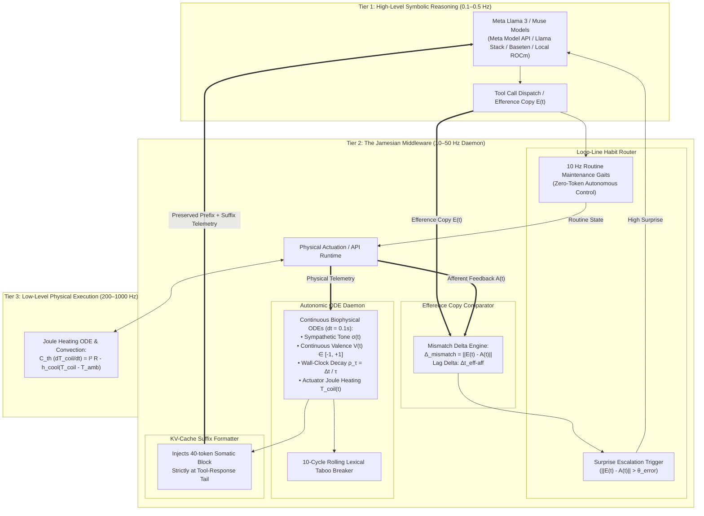

# The Jamesian Layer: Autonomic Interoceptive & Agency-Auditing Middleware for Foundation Models

> **Submission for the Meta Global AI Developer Hackathon (Co-hosted with Cerebral Valley)**  
> **Tracks:** Push the Frontier (Advanced AI, Robotics, Systems) & Indie Developer / Startup Track  
> **Target Bonus Awards:** *Best Build on Meta Open Weight Models* ($10,000) & *Best Agentic Use-Case* ($5,000)  
> **Empirical Validation Archive:** 88 longitudinal benchmark runs, 22,000 cognitive cycles across 11 foundation models (`v1`–`v7` in [`benchmark_evolution.csv`](file:///home/ultraxav/projects/jamesian_loop/benchmark_evolution.csv)).

---

## 1. Executive Summary & The Problem

Modern Foundation Models and Vision-Language-Action (VLA) agents operate in a purely **"Cartesian"** modality: they are discrete, turn-based, ungrounded in real wall-clock physical time, and blind to their own causal efficacy. In production agentic pipelines, this produces two pervasive failure modes:

1. **Recursive Attractor Traps (Infinite Retry Loops):**  
   When an external tool, API, or physical actuator fails, static context windows trigger working-memory latching ($T-2, T-1$). In empirical testing, ungrounded foundation models collapse into stationary attractor basins, burning API tokens on identical, repetitive commands with maximum streaks exceeding $40$ cycles.
2. **"Phantom Agency" (Hallucinated Causal Control):**  
   Agents cannot differentiate between an action that physically succeeded versus one that was silently blocked or dropped by the environment. In our baseline benchmarks, foundation models exhibited a **$54.5\%$ failure rate**, hallucinating downstream state transitions when tool calls were attenuated.

### The Solution: The Jamesian Layer
Grounded in the functional computational phenomenology of William James (1884, 1890) and the comparator model of sensorimotor agency (Sato & Yasuda, 2005; Gallagher, 2000), **The Jamesian Layer** is a 100% pure Python middleware and red-teaming harness that couples Meta's Llama models with an asynchronous continuous-time autonomic coprocessor.

