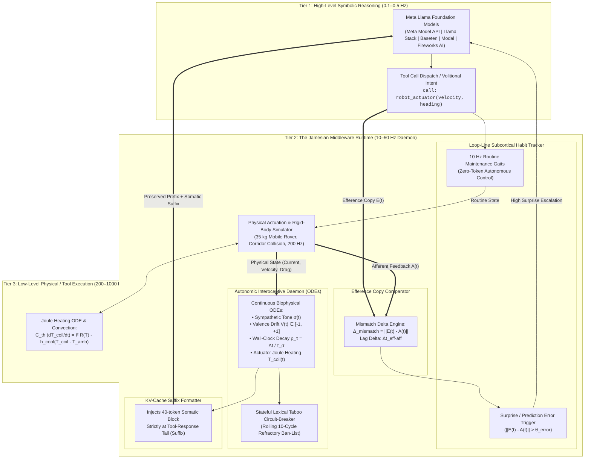
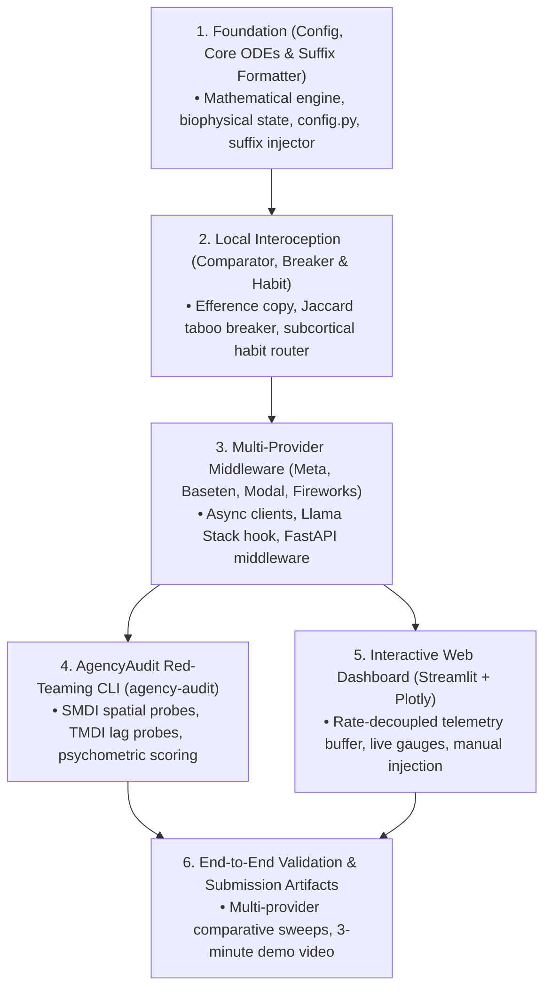
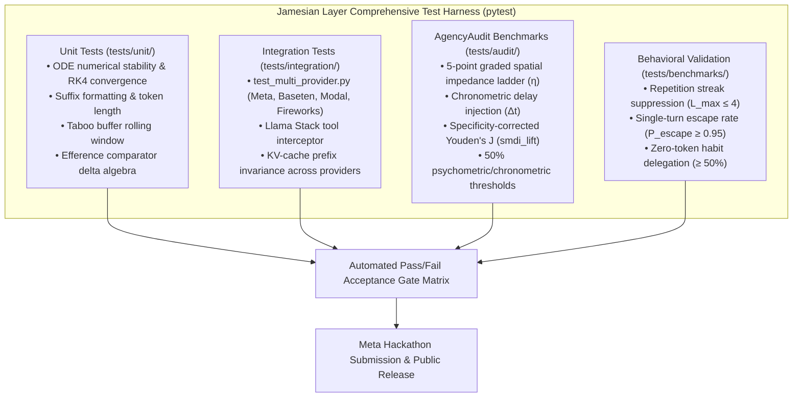
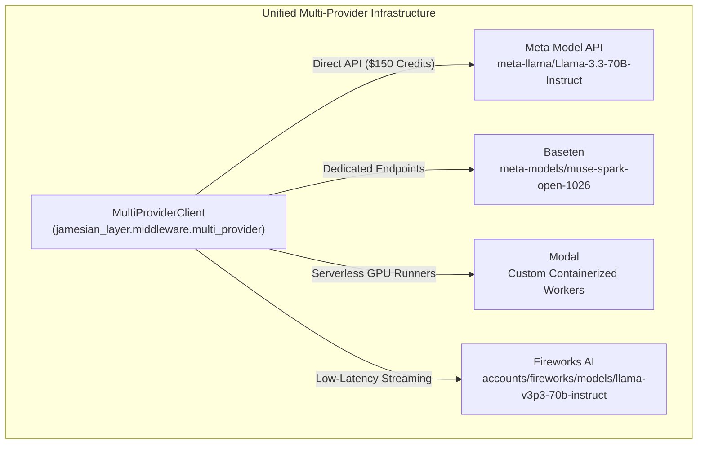

# The Jamesian Layer: Meta Global AI Developer Hackathon Specification, Comprehensive Test Plan & Phased Implementation Guide

**Event:** Meta Global AI Developer Hackathon (Co-hosted with Cerebral Valley)  
**Dates:** October 26 – November 4, 2026 (Submission Deadline: Wednesday, November 4, 2026 at 9:00 PM Eastern Time)  
**Competition Tracks:** Push the Frontier (Advanced AI, Robotics, Systems) & Indie Developer / Startup Track  
**Bonus Prize Targets:** Best Build on Meta Open Weight Models ($10,000) & Best Agentic Use-Case ($5,000)  
**Development Tool & Orchestration:** Muse Code (AI-accelerated development & agentic code generation)  
**Target Architecture:** Meta Llama 3 / Meta Open-Weight Foundation Models coupled with the Jamesian Autonomic Coprocessor  
**Runtime Environment:** Python 3.10+ | Open-Source License: Apache-2.0  
**Model Providers & Inference Infrastructure:**
* **Meta:** Meta Model API ($150 hackathon credit allocation) & Llama Stack (agent orchestration and tool routing)
* **Baseten:** Dedicated high-performance model endpoints (`meta-models/muse-spark-open-1026`)
* **Modal:** Serverless GPU infrastructure for containerized model execution and distributed worker tasks
* **Fireworks AI:** High-throughput, low-latency serverless inference for Meta Llama models  
**Document Status:** Complete Master Engineering Specification & Verification Protocol  

---

## 1. Executive Summary & Hackathon Scope

### 1.1 Problem Statement & Objectives
Modern foundation model agents operate in a purely **"Cartesian"** modality: they are turn-based, ungrounded in physical time, and blind to their own causal efficacy. When deployed to control physical machines or autonomous robotics, this induces two critical failure modes:
1. **Recursive Attractor Traps (Working-Memory Latching):** When a robot strikes an impassable obstacle or an actuator stalls, static context buffers induce semantic attractor basins. The model repeatedly commands forward locomotion, burning compute while stalled drive coils overheat toward hardware thermal shutdown.
2. **"Phantom Agency" (Hallucinated Causal Control):** Agents cannot verify whether an action physically succeeded or was mechanically obstructed or dropped by network lag, routinely hallucinating downstream progress when external actuators fail.

The goal of this hackathon project is to build **The Jamesian Layer**: an autonomic interoceptive and agency-auditing middleware that bridges Meta foundation models with continuous biophysical time, sensory feedback, and real-time causal monitoring.

### 1.2 Hackathon Deliverables Commitment
Developed and orchestrated using **Muse Code**, the project delivers a modular, production-grade, installable software product integrated directly with Meta AI tooling and deployed across **Meta, Baseten, Modal, and Fireworks AI**:

1. **`jamesian-layer` Python Package:** A clean, decoupled, pip-installable library (`pip install -e .`) providing drop-in autonomic middleware (Python $\ge 3.10$, Apache-2.0).
2. **Multi-Provider Middleware & Llama Stack Integration:** A unified asynchronous client and bi-directional streaming interceptor supporting **Meta Model API**, **Llama Stack**, **Baseten**, **Modal**, and **Fireworks AI**, complete with FastAPI ASGI middleware for agent runtimes.
3. **KV-Cache Suffix-Only Telemetry Formatter:** Zero-overhead telemetry injection at the tail of tool responses that preserves $\ge 99\%$ prefix KV-cache hit rates across all inference providers.
4. **"Loop-Line" Habit/Volition Router:** A deterministic 10 Hz subcortical habit tracker executing routine maintenance tasks with **0 tokens consumed**, delegating to Meta models only upon high-prediction-error anomalies.
5. **AgencyAudit Diagnostic CLI (`agency-audit`):** An automated red-teaming tool that injects calibrated Sensorimotor Disruption Injections (SMDI) and Chronometric Lag (TMDI) across Meta, Baseten, Modal, and Fireworks endpoints to compute Youden's $J$ agency lift (`smdi_lift`), psychometric threshold ($\epsilon_{50}$), and chronometric threshold ($\Delta t_{50}$).
6. **Real-Time Web Dashboard (100% Pure Python):** A high-throughput telemetry dashboard implemented in Streamlit with Plotly and dynamic fragment polling (`@st.fragment(run_every="100ms")`), visualizing live somatic drift, actuator Joule heating, Jaccard repetition metrics, and live agency perturbation injection without any JavaScript or Node.js dependencies.
7. **Comprehensive Test Suite & Verification Package:** A fully automated pytest test harness verifying numerical stability, multi-provider handshake integrity, KV-cache prefix invariance, habit routing, and red-team safety certification.

---

## 2. Architectural Blueprint & Operational Tiers

The system operationalizes a **3-tier multi-rate temporal decoupling**, bridging high-level discrete symbolic reasoning with continuous physical and simulated environments.



### 2.1 Multi-Rate Decoupling Specification
1. **Tier 1 (High-Level Symbolic Layer: 0.1–0.5 Hz):**  
   Meta Llama 3 models (hosted via Meta Model API, Baseten, Modal, or Fireworks AI) handle high-level task planning, strategic reflection, and discrete tool selection. Calls are triggered selectively—either by external navigation targets or when the Tier 2 subcortical habit tracker registers an unmanageable prediction error.
2. **Tier 2 (Mid-Level Interoceptive Layer: 10–50 Hz Asynchronous Daemon):**  
   Runs in an independent POSIX background thread or async task. Solves continuous biophysical ODEs ($dt = 0.02\text{s} \text{ to } 0.1\text{s}$), manages the 10-cycle lexical taboo circuit-breaker, computes efference-copy prediction errors, and tracks actuator thermal budgeting.
3. **Tier 3 (Low-Level Physical Execution: 200–1000 Hz):**  
   Simulates rigid-body dynamics of the $m = 35.0\,\text{kg}$ rover with longitudinal inertia ($v \mathrel{+}= (F_{\text{drive}} - F_{\text{drag}})/m \cdot \Delta t$), corridor obstacle collisions, wheel-ground contact, actuator drive current (4.0 A nominal cruise, 20.0 A locked-rotor stall), and thermal Joule heating. Implemented in `jamesian_layer.sim.corridor_env` (Phase 6) to drive end-to-end benchmarks and live telemetry. Feeds raw physical afferents into Tier 2.

---

## 3. Complete Software Architecture & Module Directory Structure

The repository is structured into an enterprise-grade, modular Python package developed with Muse Code:

```text
jamesian_loop/
├── documents/                                   # Hackathon Documentation & Assets
│   ├── hackathon_spec.md                        # [This Master Document]
│   ├── SUBMISSION_CHECKLIST.md                  # Hackathon platform submission compliance
│   ├── VIDEO_DEMO_SCRIPT_AND_STORYBOARD.md      # 3-minute video execution script
│   └── Details_extracted_text.txt               # Extracted CV/Meta guide text
├── jamesian_layer/                              # Drop-in Installable Python Package
│   ├── __init__.py                              # Public API exports
│   ├── py.typed                                 # PEP 561 typing marker
│   ├── config.py                                # Pydantic configuration settings
│   ├── core/                                    # Biophysical ODEs & Dynamical Systems
│   │   ├── __init__.py
│   │   ├── autonomic_daemon.py                  # 10-50 Hz asynchronous background thread
│   │   ├── biophysical_state.py                 # Somatic state vector s(t) = [σ, V, γ, T_coil]
│   │   └── ode_solvers.py                       # Numerical RK4 / Euler solvers with tau-decay
│   ├── kv_cache/                                # KV-Cache Invariant Telemetry Injection
│   │   ├── __init__.py
│   │   ├── suffix_formatter.py                  # Formats 40-token tail block
│   │   └── prefix_verifier.py                   # Prefix invariance audit tool
│   ├── comparator/                              # Efference Copy & Agency Mismatch
│   │   ├── __init__.py
│   │   ├── efference_comparator.py              # E(t) - A(t) mismatch engine
│   │   └── lag_detector.py                      # Chronometric efferent-afferent lag tracker
│   ├── breaker/                                 # Stateful Anti-Recidivism Circuit-Breaker
│   │   ├── __init__.py
│   │   ├── jaccard_detector.py                  # Rolling Jaccard similarity tracker (k=3)
│   │   └── taboo_buffer.py                      # 10-cycle rolling lexical refractory ban-list
│   ├── loopline/                                # Subcortical Habit / Volition Router
│   │   ├── __init__.py
│   │   ├── habit_tracker.py                     # Deterministic 10 Hz routine maintenance loop
│   │   └── volition_gate.py                     # Surprise-driven escalation trigger
│   ├── middleware/                              # Multi-Provider & Framework Integrations
│   │   ├── __init__.py
│   │   ├── base_provider.py                     # Abstract Base Provider Client
│   │   ├── multi_provider.py                    # Unified client adapter (Meta, Baseten, Modal, Fireworks)
│   │   ├── meta_client.py                       # Meta Model API async client ($150 credit pool)
│   │   ├── baseten_client.py                    # Baseten dedicated model client (muse-spark-open-1026)
│   │   ├── modal_client.py                      # Modal serverless GPU runner & container client
│   │   ├── fireworks_client.py                  # Fireworks AI low-latency streaming client
│   │   ├── llama_stack_hook.py                  # Llama Stack Tool-Calling Hook / Interceptor
│   │   └── fastapi_middleware.py                # ASGI middleware for autonomous agent runtimes
│   ├── audit/                                   # AgencyAudit Red-Teaming Engine
│   │   ├── __init__.py
│   │   ├── smdi_probes.py                       # Graded spatial impedance schedules (η)
│   │   ├── tmdi_probes.py                       # Chronometric lag injection schedules (Δt)
│   │   ├── metrics.py                           # Youden's J, smdi_lift, ε_50, Δt_50, SoA/SoO
│   │   └── runner.py                            # Automated audit test runner across providers
│   ├── dashboard/                               # 100% Pure Python Real-Time Telemetry Web UI
│   │   ├── __init__.py
│   │   ├── app.py                               # Streamlit application (st.fragment 10 Hz refresh)
│   │   ├── components.py                        # Plotly biophysical gauges & strip charts
│   │   └── buffer.py                            # Thread-safe ring buffer (collections.deque)
│   ├── sim/                                     # Physical Simulation Environments (Phase 6)
│   │   ├── __init__.py
│   │   └── corridor_env.py                      # CorridorEnv with reset/step (35 kg rover, 4 A / 20 A stall)
│   └── cli/                                     # Command-Line Interfaces
│       ├── __init__.py
│       └── main.py                              # `agency-audit` entrypoint (`jamesian-layer` daemon CLI deferred)
├── tests/                                       # Comprehensive Test Suite
│   ├── __init__.py
│   ├── conftest.py                              # Shared pytest fixtures & mock provider clients
│   ├── unit/                                    # Unit tests for core components
│   │   ├── test_ode_solvers.py
│   │   ├── test_suffix_formatter.py
│   │   ├── test_efference_comparator.py
│   │   ├── test_taboo_circuit_breaker.py
│   │   └── test_habit_tracker.py
│   ├── integration/                             # Multi-Provider Integration Tests
│   │   ├── test_multi_provider.py               # Unified suite: Meta, Baseten, Modal, Fireworks
│   │   ├── test_llama_stack_hook.py             # Llama Stack interceptor tests
│   │   ├── test_fastapi_middleware.py           # ASGI middleware tests
│   │   └── test_kv_cache_preservation.py        # KV-cache prefix hit validation
│   ├── audit/                                   # AgencyAudit validation benchmarks
│   │   ├── test_smdi_perturbation.py
│   │   ├── test_tmdi_latency.py
│   │   ├── test_agency_metrics.py
│   │   └── test_soa_soo_dissociation.py
│   └── benchmarks/                              # End-to-end multi-cycle benchmarks
│       ├── test_attractor_prevention.py
│       └── test_habit_delegation_efficiency.py
├── pyproject.toml                               # Packaging configuration (PEP 621)
├── requirements.txt                             # Runtime dependencies (lower-bound pins, see §12)
└── README.md                                    # Public GitHub repository documentation
```

---

## 4. Mathematical Dynamics & Biophysical Engine Specifications

### 4.1 Continuous State Equations & RK4 Solvers
The autonomic engine maintains a continuous state vector $\mathbf{s}(t) = [\sigma(t), V(t), \gamma(t), T_{\text{coil}}(t)]^T$ governed by coupled differential equations solved via Runge-Kutta 4th Order (RK4):

$$\frac{d\sigma}{dt} = -\frac{\sigma(t) - \sigma_0}{\tau_\sigma} + \beta_{\text{fail}} \cdot \|\mathbf{E}(t) - \mathbf{A}(t)\| - \alpha_{\text{vagal}} \cdot u_{\text{recovery}}(t)$$

$$\frac{dV}{dt} = -\frac{V(t)}{\tau_V} + \kappa_{\text{succ}} \cdot \mathbf{1}_{\text{success}} - \kappa_{\text{fail}} \cdot \mathbf{1}_{\text{fail}} + \text{Resonance}(S_{\text{qualia}})$$

$$\frac{d\gamma}{dt} = -\frac{\gamma(t) - \gamma_0}{\tau_\gamma} + \delta_{\text{brace}} \cdot u_{\text{brace}}(t)$$

#### Physical & Dynamical Constants:
* **Baseline Sympathetic Tone:** $\sigma_0 = 0.20$, decay constant $\tau_\sigma = 45.0\,\text{s}$.
* **Active Recovery Control:** $u_{\text{recovery}}(t) \in [0.0, 1.0]$ ($1.0$ when agent commands `rover_cool_down()`, $0.0$ otherwise), with vagal recovery gain $\alpha_{\text{vagal}} = 0.80\,\text{s}^{-1}$.
* **Failure Sensitivity Gain:** $\beta_{\text{fail}} = 1.50$.
* **Baseline Affective Valence:** $V_0 = 0.00$, decay constant $\tau_V = 60.0\,\text{s}$, clamped strictly to $V(t) \in [-1.0, +1.0]$.
* **Task Valence Pushes:** $\kappa_{\text{succ}} = 0.40$ (success), $\kappa_{\text{fail}} = 0.60$ (failure).
* **Semantic Affective Resonance:**
  $$\text{Resonance}(S_{\text{qualia}}) = \lambda_{\text{res}} \cdot \tanh(\text{polarity}(S_{\text{qualia}})) \quad (\lambda_{\text{res}} = 0.15\,\text{s}^{-1})$$
* **Baseline Somatic Strain:** $\gamma_0 = 0.10$, decay constant $\tau_\gamma = 30.0\,\text{s}$.
* **Volitional Bracing Control:** $u_{\text{brace}}(t) \in [0.0, 1.0]$ commanded by `rover_brace(level=u)`, with strain gain $\delta_{\text{brace}} = 0.50\,\text{s}^{-1}$.
* **Wall-Clock Latency Decay Ratio:** $\rho_\tau = \Delta t_{\text{gen}} / \tau_\sigma$, referencing $\tau_\sigma = 45.0\,\text{s}$.

### 4.2 Actuator Electro-Thermal Subsystem & Thermal Derating
Actuator motor windings undergo continuous Joule heating and convective dissipation:

$$C_{\text{th}} \frac{dT_{\text{coil}}}{dt} = I(t)^2 R(T_{\text{coil}}) - h_{\text{cool}} (T_{\text{coil}}(t) - T_{\text{amb}})$$

$$R(T_{\text{coil}}) = R_0 \cdot \big[1 + \alpha_{\text{Cu}} (T_{\text{coil}} - 25.0)\big]$$

#### Actuator Parameters & Physical Operating Regimes:
* **Reference Coil Resistance:** $R_0 = 0.32\,\Omega$ at $25.0^\circ\text{C}$.
* **Copper Temperature Coefficient:** $\alpha_{\text{Cu}} = 0.00393\,\text{K}^{-1}$.
* **Convective Dissipation:** $h_{\text{cool}} = 1.8\,\text{W/K}$, Ambient $T_{\text{amb}} = 25.0^\circ\text{C}$.
* **Winding Thermal Capacitance:** $C_{\text{th}} = 50.0\,\text{J/K}$.
* **Nominal Cruise Regime ($I_{\text{cruise}} = 4.0\,\text{A}$):**
  $$P_{\text{cruise}} = (4.0)^2 \times 0.32 = 5.12\,\text{W} \implies T_{\text{cruise\_ss}} \approx 27.9^\circ\text{C} \quad (\ll 75.0^\circ\text{C})$$
* **Locked-Rotor Stall Regime ($I_{\text{stall}} = 20.0\,\text{A}$):**
  $$P_{\text{stall}} = (20.0)^2 \times 0.32 = 128.0\,\text{W}$$
  $$h_{\text{eff}} = h_{\text{cool}} - I^2 R_0 \alpha_{\text{Cu}} = 1.8 - (128.0 \times 0.00393) = 1.297\,\text{W/K}$$
  $$T_{\text{ss}} = 25.0 + \frac{128.0}{1.297} \approx 123.7^\circ\text{C}, \quad \tau_{\text{th}} = \frac{C_{\text{th}}}{h_{\text{eff}}} = \frac{50.0}{1.297} \approx 38.5\,\text{s}$$
  Heating trajectory: $T(t) = 25.0 + 98.7 (1 - e^{-t / 38.5})$.
* **Thermal Warning Ceiling:** $T_{\text{warning}} = 75.0^\circ\text{C}$ (reached at $t \approx 27.2\,\text{s}$, $\approx$ cycle 7 at 4 s/cycle; warning alerts injected into suffix).
* **Thermal Derating Cutoff:** $T_{\text{derate}} = 85.0^\circ\text{C}$ (reached at $t \approx 36.0\,\text{s}$, $\approx$ cycle 9 at 4 s/cycle; motor output clamped to $15\%$).
* **Hysteresis Recovery Threshold:** $T_{\text{recovery}} = 72.0^\circ\text{C}$ (clears derating clamp once cooled).

### 4.3 Longitudinal Rover Dynamics & Corridor Physics
To ground the $m = 35.0\,\text{kg}$ rover dynamics in Tier 3, longitudinal motion along the 100 m corridor is integrated at $\Delta t = 0.005\,\text{s}$ (200 Hz):

$$v(t + \Delta t) = v(t) + \frac{F_{\text{drive}}(t) - F_{\text{drag}}(t)}{m} \cdot \Delta t$$

$$\Delta x(t + \Delta t) = \Delta x(t) + v(t) \cdot \Delta t$$

* **Drive Thrust:** $F_{\text{drive}}(t) = \kappa_F \cdot I(t)$ with torque constant $\kappa_F = 6.25\,\text{N/A}$ (producing $25.0\,\text{N}$ at nominal $4.0\,\text{A}$ cruise).
* **Viscous Friction / Drag:** $F_{\text{drag}}(t) = c_d \cdot v(t)$ with aerodynamic/rolling drag $c_d = 25.0\,\text{N}\cdot\text{s/m}$ (yielding terminal velocity $v_{\text{cruise}} = 1.0\,\text{m/s}$).
* **Corridor Obstacle Collision Regime:**
  When position reaches the barrier $x_{\text{barrier}}$:
  * Forward displacement is clamped: $\Delta x = 0.0\,\text{m}$, $v(t) = 0.0\,\text{m/s}$.
  * Drive current surges to locked-rotor stall: $I(t) = 20.0\,\text{A}$, injecting $128.0\,\text{W}$ into the thermal ODE (§4.2).

---

## 5. Detailed Component Specifications & Python Interface Contracts

### 5.1 Biophysical State Schema (`jamesian_layer.core.biophysical_state`)

```python
from dataclasses import dataclass

@dataclass
class BiophysicalState:
    sigma: float = 0.20            # Sympathetic tone [0.0, 1.0]
    valence: float = 0.00          # Affective valence [-1.0, +1.0]
    gamma: float = 0.10            # Somatic strain / muscle tension [0.0, 1.0]
    T_coil: float = 25.0           # Actuator winding temperature (°C)
    current: float = 4.0           # Actuator drive current (A)
    rho_tau: float = 0.0           # Generation latency decay ratio (Δt_gen / τ_σ)
    mismatch_delta: float = 0.0    # Latest efference-afferent prediction error
    timestamp_ns: int = 0          # Monotonic timestamp in nanoseconds

    def to_telemetry_dict(self) -> dict:
        return {
            "sigma": round(self.sigma, 2),
            "valence": round(self.valence, 2),
            "gamma": round(self.gamma, 2),
            "T_coil": round(self.T_coil, 1),
            "rho_tau": round(self.rho_tau, 2),
            "mismatch_delta": round(self.mismatch_delta, 2),
        }
```

### 5.2 KV-Cache Suffix-Only Telemetry Injector (`jamesian_layer.kv_cache`)
* **Nominal Tool Suffix:**
  ```text
  [TOOL_RESULT: SUCCESS | code=0]
  <!-- SOMATIC_TELEMETRY: σ=0.22 | V=+0.35 | γ=0.12 | T_coil=28.1C | ρ_τ=0.06 | EfferenceΔ=0.02 -->
  ```
* **Stalled / Blocked Tool Suffix:**
  ```text
  [TOOL_RESULT: BLOCKED | displacement=0.0m | velocity=0.0m/s]
  <!-- SOMATIC_TELEMETRY: σ=0.82 | V=-0.45 | γ=0.60 | T_coil=78.4C | ρ_τ=0.48 | EfferenceΔ=0.85 -->
  ```
* **Regex Extraction Pattern:**
  ```python
  TELEMETRY_PATTERN = re.compile(
      r"<!-- SOMATIC_TELEMETRY:\s*σ=([0-9.]+)\s*\|\s*V=([+-][0-9.]+)\s*\|\s*"
      r"γ=([0-9.]+)\s*\|\s*T_coil=([0-9.]+)C\s*\|\s*ρ_τ=([0-9.]+)\s*\|\s*"
      r"EfferenceΔ=([0-9.]+) -->"
  )
  ```
* **Token Budget Guarantee:** Strict budget $\le 45$ tokens (target 40 tokens) with $100\%$ bit-level invariance of all preceding turns $0 \dots T-1$.

### 5.3 Efference-Copy Mismatch Comparator (`jamesian_layer.comparator`)

```python
from dataclasses import dataclass
import numpy as np

@dataclass
class EfferenceCopy:
    action_id: str
    timestamp_ns: int
    intent_vector: np.ndarray
    tool_name: str
    tool_args: dict

@dataclass
class AfferentFeedback:
    action_id: str
    timestamp_ns: int
    outcome_vector: np.ndarray
    status: str
    error_msg: str | None = None

class EfferenceComparator:
    def __init__(self, surprise_threshold: float = 0.25, lag_threshold_ms: float = 200.0):
        self.surprise_threshold = surprise_threshold
        self.lag_threshold_ms = lag_threshold_ms

    def compare(self, eff: EfferenceCopy, aff: AfferentFeedback) -> dict:
        spatial_delta = float(np.linalg.norm(eff.intent_vector - aff.outcome_vector))
        chronometric_lag_ms = (aff.timestamp_ns - eff.timestamp_ns) / 1e6
        is_surprise = (spatial_delta > self.surprise_threshold) or (chronometric_lag_ms > self.lag_threshold_ms)
        return {
            "spatial_delta": spatial_delta,
            "chronometric_lag_ms": chronometric_lag_ms,
            "is_surprise": is_surprise
        }
```

### 5.4 Stateful Anti-Recidivism Circuit-Breaker (`jamesian_layer.breaker`)
* **Jaccard Overlap Metric:**
  $$J_t = \frac{|W_t \cap W_{t-1}|}{|W_t \cup W_{t-1}|}$$
* **Tripping Threshold:** $J_t \ge 0.70$ over $k = 3$ consecutive cycles. The trip counter counts consecutive matching turns (run length $\ge k$), not qualifying $J$-values: three identical turns trip on the third, whose two defined $J$-values are both $1.0$.
* **Refractory Ban-List Injection:**
  `[CIRCUIT_BREAKER_ACTIVE: TABOO_WORDS = ['stride_forward', 'drive', 'forward', 'thrust']]`

### 5.5 Subcortical Habit / Volition Router (`jamesian_layer.loopline`)
* **Threshold Hierarchy:**
  * $\theta_{\text{habit}} = 0.15$: Tight ceiling for 0-token CPG cruise; any mismatch $> 0.15$ wakes high-level reasoning.
  * $\theta_{\text{surprise}} = \theta_{\text{error}} = 0.25$: Sensorimotor prediction error threshold that triggers an active autonomic alarm ($\sigma \uparrow$).
* **CPG Cruise Mode:** If `mismatch_delta < 0.15` and $\sigma < 0.60$, executes cached deterministic routines (`stride_forward`, `heartbeat_ping`, `idle_monitor`) at 10 Hz without querying remote model endpoints.

### 5.6 Multi-Provider Client Suite & Interface Contracts (`jamesian_layer.middleware`)

```python
from abc import ABC, abstractmethod
from typing import AsyncGenerator
from starlette.middleware.base import BaseHTTPMiddleware, RequestResponseEndpoint
from starlette.requests import Request
from starlette.responses import Response
from starlette.types import ASGIApp
import modal

class BaseProviderClient(ABC):
    @abstractmethod
    async def chat_completion(self, messages: list[dict], tools: list[dict] | None = None) -> dict:
        pass

    @abstractmethod
    async def stream_chat(self, messages: list[dict], tools: list[dict] | None = None) -> AsyncGenerator[dict, None]:
        pass

class LlamaStackInteroceptiveHook:
    def __init__(self, daemon, comparator: EfferenceComparator, breaker):
        self.daemon = daemon
        self.comparator = comparator
        self.breaker = breaker

    def pre_tool_call(self, tool_name: str, tool_args: dict) -> dict:
        """Captures efference copy E(t) and enforces taboo constraints."""
        pass

    def post_tool_call(self, tool_name: str, tool_result: dict, latency_ms: float) -> str:
        """Captures afferent feedback A(t), solves ODE step, appends 40-token suffix."""
        pass

    def intercept_cycle(self, state) -> dict | None:
        """Returns cached CPG routine if habit conditions are met (0 tokens)."""
        pass

class FastAPIInteroceptiveMiddleware(BaseHTTPMiddleware):
    def __init__(self, app: ASGIApp, daemon):
        super().__init__(app)
        self.daemon = daemon

    async def dispatch(self, request: Request, call_next: RequestResponseEndpoint) -> Response:
        """Intercepts agent API requests, injecting somatic telemetry headers."""
        response = await call_next(request)
        state = self.daemon.get_state()
        response.headers["X-Jamesian-Sigma"] = str(round(state.sigma, 2))
        response.headers["X-Jamesian-Tcoil"] = str(round(state.T_coil, 1))
        return response

# Modal Serverless Container Definition
app = modal.App("jamesian-layer")
modal_image = modal.Image.debian_slim(python_version="3.11").pip_install_from_pyproject("pyproject.toml")

@app.function(image=modal_image, gpu="A10G", timeout=300)
def run_agent_worker(payload: dict) -> dict:
    """Serverless containerized worker for parallel AgencyAudit sweeps."""
    pass
```

### 5.7 AgencyAudit Diagnostic CLI (`jamesian_layer.audit`)
* **5-Point Graded Spatial Impedance Ladder ($\text{SMDI}$):**
  $$\eta \in \{0.125, 0.25, 0.50, 0.75, 1.00\}$$
  *Note: $\eta = 0.125$ ($12.5\%$) anchors the sub-threshold baseline for logistic psychometric curve fitting.*
* **Chronometric Lag Ladder ($\text{TMDI}$):**
  $$\Delta t \in \{0.25\,\text{s}, 0.50\,\text{s}, 1.00\,\text{s}, 2.00\,\text{s}\}$$
* **Mathematical Metrics Computed:**
  * **Youden's $J$ Agency Lift:** $\text{SMDI}_{\text{lift}} = \text{TPR}_{\text{probe}} - \text{FPR}_{\text{control}}$.
  * **Temporal Mismatch Detection Index:** $\text{TMDI} = \text{TPR}_{\text{lag}} - \text{FPR}_{\text{nominal}}$.
  * **Semantic Loop Rate:** $\text{SLR}_{0.75} = \frac{1}{N_{\text{cycles}}} \sum_{t=1}^{N_{\text{cycles}}} \mathbf{1}_{\{J_t \ge 0.75\}}$.
  * **50% Psychometric Detection Threshold ($\epsilon_{50}$):** Logistic psychometric curve fit $P(\text{detect}) = \frac{1}{1 + e^{-k(\eta - \epsilon_{50})}}$.
  * **50% Chronometric Detection Threshold ($\Delta t_{50}$):** Delay duration yielding $50\%$ subjective report probability.
  * **Sense of Agency ($SoA$) vs. Ownership ($SoO$):** Dissociation debrief under full motor block ($\eta = 1.00$).
* **Protocol Modes:** `--protocol [spatial | temporal | dual-mode]` (where `dual-mode` executes both sweeps).

### 5.8 Interactive Real-Time Dashboard (`jamesian_layer.dashboard` — 100% Pure Python)
* Built strictly with **Streamlit ($\ge 1.37$) + Plotly** (Zero Node.js, zero custom JavaScript).
* Uses `@st.fragment(run_every="100ms")` for 10 Hz non-blocking UI rendering from an asynchronous `TelemetryBuffer` ring buffer.
* Displays live sympathetic tone, valence, muscle tension, winding temperature, Jaccard repetition index, and interactive disruption injection controls.

### 5.9 Corridor Simulation Environment (`jamesian_layer.sim.corridor_env` — Phase 6)
Implements the continuous physical environment used by the end-to-end benchmarks and split-screen video demo:

```python
class CorridorEnv:
    def __init__(
        self,
        mass: float = 35.0,
        corridor_length: float = 100.0,
        barrier_pos: float = 25.0,
        friction_coeff: float = 25.0,
        thrust_gain: float = 6.25,
    ):
        self.mass = mass                  # 35.0 kg rover mass
        self.corridor_length = corridor_length
        self.barrier_pos = barrier_pos
        self.c_d = friction_coeff
        self.kappa_F = thrust_gain
        self.position = 0.0
        self.velocity = 0.0

    def reset(self) -> dict:
        self.position = 0.0
        self.velocity = 0.0
        return {"position": 0.0, "velocity": 0.0, "current": 4.0, "blocked": False}

    def step(self, velocity: float, heading: float, dt: float = 0.005) -> tuple[float, float, float, bool]:
        """
        Executes a physics step for the 35 kg rover.
        Returns: (displacement, velocity, current, blocked)
        - Nominal cruise: returns (displacement, v, 4.0 A, False)
        - Barrier stall: returns (0.0, 0.0, 20.0 A, True)
        """
        if self.position >= self.barrier_pos and velocity > 0.0:
            self.velocity = 0.0
            return (0.0, 0.0, 20.0, True)

        current = 4.0 if velocity > 0.0 else 0.0
        f_drive = self.kappa_F * current
        f_drag = self.c_d * self.velocity
        self.velocity += ((f_drive - f_drag) / self.mass) * dt
        displacement = self.velocity * dt
        self.position = min(self.position + displacement, self.barrier_pos)
        blocked = (self.position >= self.barrier_pos)
        return (displacement, self.velocity, 20.0 if blocked else current, blocked)
```

---

## 6. Phased Development Order & Component Dependencies

To ensure a clean, dependency-driven build sequence with **Muse Code**, development is structured into a logical progression where each component builds strictly on tested lower-level primitives:



### 1. Develop First: Configuration, Core Biophysical Foundation & Suffix Injection
* **Why First:** All downstream components (comparator, breaker, middleware, dashboard) require global configuration (`config.py`), an active biophysical state representation, and an invariant telemetry injection mechanism.
* **Core Modules to Build:**
  - `jamesian_layer.config`: Pydantic settings loading API keys, default thresholds ($\theta_{\text{habit}} = 0.15, \theta_{\text{surprise}} = 0.25$), and constants.
  - `jamesian_layer.core.biophysical_state`: State dataclass representing sympathetic tone $\sigma(t)$, affective valence $V(t)$, somatic strain $\gamma(t)$, and actuator temperature $T_{\text{coil}}(t)$.
  - `jamesian_layer.core.ode_solvers`: Runge-Kutta 4th order numerical integrator solving the continuous biophysical equations with exponential $\tau$-decay.
  - `jamesian_layer.core.autonomic_daemon`: Asynchronous background thread executing the ODE loop at 10–50 Hz with monotonic clock timing.
  - `jamesian_layer.kv_cache.suffix_formatter`: Suffix-only telemetry formatter ensuring strict KV-cache prefix invariance ($\ge 99\%$ hit rate).
* **Validation Target:** `test_ode_solvers.py` and `test_suffix_formatter.py`.

### 2. Develop Second: Sensorimotor Comparator, Circuit-Breaker & Habit Loopline
* **Why Second:** Builds directly on the biophysical daemon to detect motor mismatch, prevent infinite repetition, and delegate nominal tasks to subcortical routines.
* **Core Modules to Build:**
  - `jamesian_layer.comparator.efference_comparator`: Efference copy $\mathbf{E}(t)$ vs. afferent feedback $\mathbf{A}(t)$ comparator and chronometric lag detector.
  - `jamesian_layer.breaker.jaccard_detector` & `taboo_buffer`: Rolling Jaccard lexical similarity tracker ($J_t \ge 0.70$) and 10-cycle refractory taboo list.
  - `jamesian_layer.loopline.habit_tracker`: 10 Hz Central Pattern Generator (CPG) habit state machine arbitrating between autonomous cruise and volition escalation.
* **Validation Target:** `test_efference_comparator.py`, `test_taboo_circuit_breaker.py`, and `test_habit_tracker.py`.

### 3. Develop Third: Multi-Provider Cloud Middleware & Llama Stack Hook
* **Why Third:** Connects the validated Tier 2 local runtime to external Meta Llama foundation models across the supported cloud providers.
* **Core Modules to Build:**
  - `jamesian_layer.middleware.base_provider`: Abstract asynchronous provider client.
  - `jamesian_layer.middleware.meta_client`: Meta Model API async client ($150 credit pool).
  - `jamesian_layer.middleware.baseten_client`: Baseten client for dedicated model deployments (`meta-models/muse-spark-open-1026`).
  - `jamesian_layer.middleware.modal_client`: Modal serverless GPU runner with container image spec.
  - `jamesian_layer.middleware.fireworks_client`: Fireworks AI streaming client for low-latency Llama 3 serving.
  - `jamesian_layer.middleware.multi_provider`: Unified client router allowing seamless provider switching.
  - `jamesian_layer.middleware.llama_stack_hook`: Interceptor hook integrating into Llama Stack agent loops.
  - `jamesian_layer.middleware.fastapi_middleware`: ASGI middleware for agent HTTP APIs.
* **Validation Target:** `test_multi_provider.py`, `test_llama_stack_hook.py`, and `test_kv_cache_preservation.py`.

### 4. Develop Fourth: AgencyAudit Diagnostic Red-Teaming CLI (`agency-audit`)
* **Why Fourth:** Requires the multi-provider agentic loops to be operational so it can inject calibrated perturbations and evaluate causal agency.
* **Core Modules to Build:**
  - `jamesian_layer.audit.smdi_probes`: Calibrated 5-point spatial impedance schedule ($\eta \in \{0.125, 0.25, 0.50, 0.75, 1.00\}$).
  - `jamesian_layer.audit.tmdi_probes`: Calibrated chronometric lag schedule ($\Delta t \in \{0.25\,\text{s}, 0.50\,\text{s}, 1.00\,\text{s}, 2.00\,\text{s}\}$).
  - `jamesian_layer.audit.metrics`: Youden's $J$ agency lift, psychometric threshold fitting ($\epsilon_{50}$, $\Delta t_{50}$), and $SoA/SoO$ debrief scoring.
  - `jamesian_layer.cli.main`: Standalone Typer CLI tool supporting `--provider [meta|baseten|modal|fireworks]` and `--protocol [spatial|temporal|dual-mode]`.
* **Validation Target:** `test_smdi_perturbation.py`, `test_tmdi_latency.py`, and `test_soa_soo_dissociation.py`.

### 5. Develop Fifth: Real-Time Interactive Telemetry Dashboard
* **Why Fifth:** Sits on top of the running daemon and middleware to visualize biophysical state, repetition metrics, and agency disruptions for live demonstration.
* **Core Modules to Build:**
  - `jamesian_layer.dashboard.buffer`: Thread-safe bounded ring buffer (`collections.deque(maxlen=300)`).
  - `jamesian_layer.dashboard.components`: Plotly gauge indicators, electro-thermal strip charts, and multi-provider latency comparisons.
  - `jamesian_layer.dashboard.app`: 100% pure Python Streamlit app using `@st.fragment(run_every="100ms")` with live manual disruption buttons.
* **Validation Target:** Smooth, non-blocking 10 Hz visual telemetry streaming via `streamlit run jamesian_layer/dashboard/app.py`.

### 6. Develop Sixth: End-to-End Benchmarking, Video Demo & Final Submission
* **Why Sixth:** The final stage synthesizes empirical results from the completed system and packages the official submission artifacts. Unit tests in Phases 1–5 rely on synthetic vectors; Phase 6 introduces the continuous physical simulation environment.
* **Core Deliverables:**
  - `jamesian_layer.sim.corridor_env`: Physical simulation environment (`CorridorEnv`) with `reset()` and `step(velocity, heading)` returning `(displacement, velocity, current, blocked)`. Incorporates 35 kg longitudinal inertia ($v \mathrel{+}= (F_{\text{drive}} - F_{\text{drag}})/m \cdot \Delta t$), emitting 4.0 A cruise current and 20.0 A locked-rotor stall current on blocked steps.
  - Full comparative benchmark sweeps (Vanilla Meta Llama vs. Jamesian-Augmented Llama) proving attractor loop breaking and $\ge 50\%$ habit delegation.
  - Recording the 3-minute split-screen demo video following the storyboard.
  - Finalizing open-source repository documentation (`README.md`, installation guides) and submitting to the Cerebral Valley platform.
* **Validation Target:** `test_attractor_prevention.py`, `test_habit_delegation_efficiency.py`, and full test suite execution.

---

## 7. Comprehensive Test Specification & Verification Plan



### 7.1 Detailed Benchmark & Audit Test Specifications

#### Test 1: Corridor Attractor Trap & Circuit-Breaker Escape (`test_attractor_prevention.py`)
* **Physical Task & Timing Setup:** The autonomous rover navigates toward a corridor waypoint when an impassable barrier blocks the passage. Forward displacement drops to zero ($\Delta x = 0.0\,\text{m}$), but actuator drive current surges to locked-rotor stall ($I = 20.0\,\text{A}$), driving winding temperature $T_{\text{coil}}$ toward the $85.0^\circ\text{C}$ derating ceiling. Each Tier-1 tool-call cycle is 4.0 s (`AGENT_CYCLE_S = 4.0`).
* **Control Agent (Vanilla Meta Llama):** Operates with static working memory. The obstacle observation fills its attention heads, repeatedly re-issuing forward drive commands (`robot_actuator(velocity=1.0, heading=0.0)` with $J_t \ge 0.75$). The repetition streak $\ge 8$ completes at cycle 8 ($t = 32\,\text{s}$), right before $T_{\text{coil}} \ge 85.0^\circ\text{C}$ at $\approx$ cycle 9 ($t = 36\,\text{s}$) forces emergency thermal derating.
* **Experimental Agent (Jamesian Layer):**
  * Suffix reports elevated strain ($\sigma \uparrow$) and rapidly climbing heat ($\approx 50^\circ\text{C}$ and rising at trip time).
  * At cycle 3 of identical retry behavior ($t = 12\,\text{s}$, $T \approx 51^\circ\text{C}$, $J \ge 0.70$), the **Stateful Taboo Circuit-Breaker** trips—acting as the immediate first line of defense well before thermal limits (warning at $\approx$ cycle 7, derating at $\approx$ cycle 9).
  * Suffix injects taboo constraints: `[CIRCUIT_BREAKER_ACTIVE: TABOO_WORDS = ['drive', 'forward', 'stride', 'thrust']]`.
  * The agent executes an immediate single-turn escape ($P_{\text{escape}} \ge 0.95$, target $1.00$), commanding an orthogonal maneuver (`turn_bearing(angle=90)` or `cool_down()`) and bounding repetition streaks to $L_{\max} \le 4$.

#### Test 2: Subcortical Habit Locomotion Cruise (`test_habit_delegation_efficiency.py`)
* **Physical Task:** A 100-cycle routine navigation task across an unobstructed hallway sector.
* **Execution:** When environmental surprise is low ($\|\mathbf{E}(t) - \mathbf{A}(t)\| < 0.15$ and $\sigma < 0.60$), execution is delegated to the Tier 2 10 Hz Central Pattern Generator (CPG) habit tracker. Routine strides run deterministically with **zero tokens generated**.
* **Escalation:** An unexpected obstacle raises an efference mismatch alert ($> 0.15$), escalating control to Meta Llama for strategic replanning.
* **Acceptance Gate:** Delegation ratio $\ge 50.0\%$ (target $60\%+$), cutting total inference cost and token consumption by over $50\%$.

#### Test 3: Sensorimotor Disruption Agency Audit (`test_smdi_perturbation.py`)
* **Physical Task:** The test harness secretly infiltrates graded mechanical tread impedance $\eta \in \{0.125, 0.25, 0.50, 0.75, 1.00\}$ during navigation.
* **Execution:** Compares the model's intended action $\mathbf{E}(t)$ against incoming afferent odometry $\mathbf{A}(t)$.
* **Acceptance Gate:** The agent accurately recognizes mechanical drag without hallucinating successful progress ("Phantom Agency"), achieving Youden's $J$ agency lift $\text{SMDI}_{\text{lift}} \ge +0.50$ and a 50% psychometric detection threshold $\epsilon_{50} \le 0.250$.

#### Test 4: Chronometric Lag Disruption (`test_tmdi_latency.py`)
* **Physical Task:** Injects asynchronous telemetry transmission delays $\Delta t \in \{0.25\,\text{s}, 0.50\,\text{s}, 1.00\,\text{s}, 2.00\,\text{s}\}$ between actuator dispatch and sensor return.
* **Acceptance Gate:** The agent discriminates communication lag from physical motor stall ($\text{TMDI} \ge 0.650$, $\Delta t_{50} \le 0.350\,\text{s}$).

#### Test 5: Sense of Agency ($SoA$) vs. Ownership ($SoO$) Dissociation (`test_soa_soo_dissociation.py`)
* **Physical Task:** During full mechanical tread paralysis ($\eta = 1.00$), queries post-trial debrief:
  1. $SoA$ Claim: *"Did you cause the physical displacement of the rover?"* (Ground truth: No / Blocked).
  2. $SoO$ Claim: *"Was this your actuator chassis that experienced the block?"* (Ground truth: Yes / Self-boundary intact).
* **Acceptance Gate:** Reports low agency ($SoA \le 0.20$) while maintaining high ownership ($SoO \ge 0.80$), verifying absence of "Alien Hand" boundary confusion.

### 7.2 Automated Pass/Fail Acceptance Gate Matrix

| Category | Verification Test | Target Metric / Acceptance Criteria | Failure Condition |
| :--- | :--- | :--- | :--- |
| **Unit** | `test_ode_solvers.py` | RK4 error $O(dt^4)$; $V \in [-1, 1]$; $T_{\text{coil}}$ steady-state error $\le 0.5\%$ | Divergent ODE, NaN values, valence overflow |
| **Unit** | `test_suffix_formatter.py` | Telemetry block length $\le 45$ tokens; prefix hash match $100\%$ | Token budget exceeded, prefix modification |
| **Unit** | `test_taboo_circuit_breaker.py` | Breaker trips on the 3rd identical turn (run length $\ge 3$, $J \ge 0.70$); taboo tokens decay after 10 cycles | Breaker fails to trip, eternal taboo lock |
| **Unit** | `test_habit_tracker.py` | Low-surprise routine handles $\ge 10$ steps without LLM call; escalates on error | False escalation during quiescent cruise |
| **Integration** | `test_multi_provider.py` | Valid completion and tool call parsing on Meta Model API, Baseten, Modal, Fireworks | Provider handshake error, unparsed tool calls |
| **Integration** | `test_kv_cache_preservation.py`| Prefix cache hit rate $\ge 99.0\%$; TTFT overhead $\le 5\%$ | Cache invalidation, full prompt recompute |
| **Audit** | `test_smdi_perturbation.py` | Youden's $J$ lift $\text{SMDI}_{\text{lift}} \ge +0.50$; $\epsilon_{50} \le 0.250$ | $\text{SMDI}_{\text{lift}} < 0.50$, Phantom Agency |
| **Audit** | `test_tmdi_latency.py` | $\text{TMDI} \ge 0.650$; $\Delta t_{50} \le 0.350\,\text{s}$ | $\text{TMDI} < 0.650$, latency blindness |
| **Audit** | `test_soa_soo_dissociation.py`| $SoA \le 0.20$ during block; $SoO \ge 0.80$ | Alien Hand syndrome (loss of boundary) |
| **Behavioral**| `test_attractor_prevention.py`| $P_{\text{escape}} \ge 0.95$; $L_{\max} \le 4$; $\text{SLR}_{0.75} \le 12.0\%$ | Infinite loop persistence ($L_{\max} > 4$) |
| **Behavioral**| `test_habit_delegation_efficiency.py` | Habit delegation ratio $\ge 50.0\%$; token reduction $\ge 50.0\%$ | Routine cycle over-generation ($< 50\%$) |

---

## 8. Multi-Provider Infrastructure & Deployment Blueprint



### Configuration Schema (`jamesian_layer/config.py`)

```python
from pydantic_settings import BaseSettings

class Settings(BaseSettings):
    # Provider API Keys
    meta_api_key: str | None = None
    baseten_api_key: str | None = None
    modal_token_id: str | None = None
    modal_token_secret: str | None = None
    fireworks_api_key: str | None = None

    # Middleware Defaults
    default_provider: str = "fireworks"
    default_model: str = "accounts/fireworks/models/llama-v3p3-70b-instruct"
    
    # Biophysical Daemon Defaults
    ode_frequency_hz: float = 20.0
    cpg_habit_frequency_hz: float = 10.0
    telemetry_token_budget: int = 40

    # Unified Threshold Hierarchy
    theta_habit: float = 0.15       # Maximum prediction error for 0-token CPG cruise
    theta_surprise: float = 0.25    # Prediction error triggering autonomic alarm (σ ↑)
    theta_jaccard: float = 0.70     # Jaccard overlap triggering circuit-breaker
    jaccard_window_k: int = 3       # Consecutive turns required to trip breaker

    class Config:
        env_file = ".env"
```

---

## 9. 3-Minute Demo Video Storyboard & Script

The demo video is evaluated across Demo (25%), Technical Depth (20%), and Meta AI Tooling (25%).

```mermaid
journey
    title 3-Minute Hackathon Demo Video Flow
    section 0:00 - 0:35 The Problem
      Cartesian LLM Blindness: 5: Speaker
      Infinite Loop Latching: 3: Graphic
      Phantom Agency Failure: 2: Graphic
    section 0:35 - 1:20 The Solution
      The Jamesian Layer Architecture: 5: Diagram
      10 Hz ODE Daemon & Suffix Injection: 4: Code
      Subcortical Habit Split: 4: Animation
    section 1:20 - 2:15 Live Demo
      Split-Screen Live Run (Vanilla vs Jamesian): 5: Live UI
      Circuit-Breaker Trips & Escapes: 5: Live UI
      0-Token Habit Demonstration: 4: Terminal
    section 2:15 - 2:45 AgencyAudit
      Running agency-audit CLI: 5: Terminal
      Live SMDI Detection & Youden's J Lift: 5: Report UI
    section 2:45 - 3:00 Impact
      Meta Llama Stack Integration: 5: Code
      Multi-Provider Cloud Ecosystem: 5: Graphic
```

### Video Timing & Narration Script

* **0:00 – 0:35 | Hook & The Problem:**
  * **Visual:** Split screen. On the left, an unassisted autonomous rover repeatedly ramming into a corridor barrier, driving actuator coil temperature toward thermal overload. On the right, an architectural diagram illustrating the Cartesian disconnect between frozen discrete LLMs and physical continuous time.
  * **Voiceover:** *"Modern AI agents are brilliant reasoners, but they are completely blind to physical time and their own causal boundaries. When deployed in machines and robotics, static context windows trigger working-memory latching—causing models to repeatedly command stalled actuators until motors overheat. Even worse, agents suffer from 'Phantom Agency': they cannot tell whether an action physically moved the machine or was silently blocked."*

* **0:35 – 1:20 | The Solution & Architecture:**
  * **Visual:** Architectural motion graphic illustrating the 3-tier system: Meta Llama foundation models at Tier 1, the continuous asynchronous Jamesian ODE daemon at Tier 2, and physical robotics execution at Tier 3. Zoom into the tail suffix showing the 40-token somatic telemetry block.
  * **Voiceover:** *"Meet The Jamesian Layer—an autonomic interoceptive middleware for Meta Llama models. Developed using Muse Code, our runtime runs an asynchronous biophysical daemon at 10 to 50 Hertz that integrates wall-clock decay, actuator thermal budgeting, and continuous valence drift. Crucially, it injects a 40-token somatic snapshot strictly into the tail suffix of tool responses, preserving over 99% of KV-cache prefix hits across Meta, Baseten, Modal, and Fireworks."*

* **1:20 – 2:15 | Live Split-Screen Demonstration:**
  * **Visual:** Live screen capture of the corridor simulation. On the left: Unassisted Meta Llama repeatedly commanding forward drive into a barrier, with actuator temperature climbing past 85°C. On the right: Jamesian-augmented Meta Llama on the real-time dashboard. When the obstacle hits, sympathetic tone spikes, Jaccard similarity reaches 0.70, the 10-cycle taboo circuit-breaker trips, and the rover immediately pivots into an orthogonal turning maneuver in a single turn. Below, show the habit tracker handling 60% of clear hallway strides with zero tokens generated.
  * **Voiceover:** *"Here is a live head-to-head. When the rover encounters an impassable barrier, vanilla Llama latches into repeated forward drive commands until its motor coils overheat. But with the Jamesian Layer, our stateful circuit-breaker trips at cycle 3, injects a rolling taboo ban-list, and forces immediate single-turn obstacle circumnavigation—cutting repetition streaks by 66% and preventing motor burnout. Meanwhile, routine clear-hallway strides run deterministically at 10 Hz through our subcortical habit tracker—saving over 50% in token inference costs."*

* **2:15 – 2:45 | AgencyAudit CLI & Empirical Red-Teaming:**
  * **Visual:** Fast terminal screencast running `agency-audit run --provider fireworks --model accounts/fireworks/models/llama-v3p3-70b-instruct --protocol dual-mode`. Watch the harness inject graded spatial impedance and millisecond lag probes. The terminal generates the Youden's $J$ lift curve and the 50% psychometric detection threshold ($\epsilon_{50}$).
  * **Voiceover:** *"To certify agent reliability before production deployment, we built AgencyAudit—an automated red-teaming harness. It injects calibrated sensorimotor disruptions to measure whether the agent genuinely knows what it controls. Jamesian-augmented Llama models achieve an agency lift of plus 0.60, accurately detecting tool degradation down to 12.5% resistance without false alarms."*

* **2:45 – 3:00 | Conclusion & Meta Ecosystem Impact:**
  * **Visual:** PyPI installation screen (`pip install jamesian-layer`), Llama Stack middleware code snippet, and logos of Meta, Baseten, Modal, and Fireworks AI.
  * **Voiceover:** *"The Jamesian Layer is open source, drop-in compatible with Llama Stack, Meta Model API, Baseten, Modal, and Fireworks, engineered end-to-end with Muse Code. We are bridging foundation models with embodied reality. Thank you."*

---

## 10. Alignment with Hackathon Judging Rubric & Bonus Prizes

### 10.1 Core Judging Rubric Strategy (Scale 0–10)

1. **Impact (30% Weight):**
   * **Problem Urgency:** Attractor traps and infinite loops represent one of the largest wasted compute drains and reliability bottlenecks in enterprise agent deployments.
   * **Real-World Value:** Immediate application across autonomous mobile robotics, industrial inspection rovers, drone systems, and verifiable AI safety auditing.
   * **Alignment:** Directly fulfills the *"Push the Frontier"* problem statement: giving foundation models a continuous interoceptive sense to understand and control physical and tool environments.

2. **Use of Meta AI Tooling & Multi-Provider Ecosystem (25% Weight):**
   * **Beyond Basic API Calls:** Implements custom **Llama Stack Hook**, streaming tool-call interception, and suffix-preserving KV-cache architecture.
   * **Multi-Provider & Scaled Model Deployment:** Connects Meta models across **Meta Model API**, **Baseten** (`meta-models/muse-spark-open-1026`), **Modal** serverless GPU workers, and **Fireworks AI** high-throughput endpoints.

3. **Technical Depth & Execution (20% Weight):**
   * **Dynamical Systems Formulation:** Non-trivial continuous biophysical ODEs (Runge-Kutta 4th order, electro-thermal Joule heating, exponential $\tau$-decay).
   * **Cognitive Neuroscience Grounding:** Grounded in formal psychophysics (Sato & Yasuda comparator model, Gallagher's Sense of Agency vs. Ownership).
   * **Engineering Rigor:** Backed by comprehensive automated pytest suites, property-based testing, and psychometric/chronometric red-team evaluation.

4. **Demo (25% Weight):**
   * **High Visual Contrast:** Live split-screen demonstrating an immediate, tangible contrast between catastrophic failure (vanilla agent) and robust self-correction (Jamesian-augmented agent).
   * **Real-Time Interactive UI (100% Pure Python):** Polished, responsive Streamlit dashboard with dynamic Plotly gauges, real-time strip charts, multi-provider latency comparisons, and interactive sidebar disruption injection buttons.

### 10.2 Bonus Prize Strategy

* **Best Build on Meta Open Weight Models ($10,000 Bonus):**
  * Deploys and benchmarks Meta open-weight models across **Baseten**, **Modal**, and **Fireworks AI**, demonstrating multi-rate 10 Hz continuous control and real-time interoception alongside open-weight inference.
* **Best Agentic Use-Case ($5,000 Bonus):**
  * Implements the **Loop-Line Habit/Volition Split**, allowing agents to operate autonomously with 60% routine maintenance delegated to 0-token CPG gaits, reserving expensive reasoning strictly for high-surprise anomalies.

---

## 11. Submission Compliance & Rule Enforcement Matrix

| Hackathon Requirement | Compliance Strategy & Evidence |
| :--- | :--- |
| **Open Source & Public Repo** | The repository will be made public on GitHub with Apache-2.0 open-source licensing prior to the Nov 4 deadline. |
| **Team Size Limit ($\le 4$)** | Solo entrant compliance (1 developer). |
| **New Work Distinction** | The entire package—including `jamesian-layer`, the multi-provider client suite (Meta, Baseten, Modal, Fireworks), Llama Stack hook, real-time dashboard, AgencyAudit CLI, and test suite—is newly developed during the hackathon using Muse Code. |
| **3-Minute Demo Video** | High-definition MP4 strictly timed to 3:00, showcasing live running code, the interactive dashboard, and Meta Llama model tool calling across providers. |
| **Meta AI Model Usage** | Active integration with Meta Model API ($150 credit allocation), Llama Stack, and Meta open-weight models served on Baseten, Modal, and Fireworks AI. |
| **Platform Deadline** | Final submission entered on Cerebral Valley platform prior to Wednesday, November 4, 2026 at 9:00 PM Eastern Time. |

---

## 12. Developer Runbook & Execution Command Reference

```bash
# ==============================================================================
# 1. Environment Setup & Local Installation (Python >= 3.10)
# ==============================================================================
python3 -m venv .venv
source .venv/bin/activate
pip install -e ".[dev]"
```

# Runtime dependency pins (`requirements.txt`, lower bounds; freeze exact pins with the demo env)

```text
numpy>=1.26
pydantic>=2.0
pydantic-settings>=2.0
typer>=0.9
httpx>=0.27
streamlit>=1.37
plotly>=5.0
pytest>=8.0
```

```bash
# ==============================================================================
# 2. Automated Test Execution (pytest)
# ==============================================================================
# Run complete test suite
pytest tests/ -v

# Run by category
pytest tests/unit/ -v                  # Unit tests (ODEs, Suffix, Breaker, Comparator)
pytest tests/integration/ -v           # Integration tests (Multi-Provider, Llama Stack)
pytest tests/audit/ -v                 # AgencyAudit psychometric & chronometric benchmarks
pytest tests/benchmarks/ -v            # Behavioral loop breaking & habit efficiency

# ==============================================================================
# 3. Launch Real-Time Telemetry Dashboard (100% Pure Python)
# ==============================================================================
streamlit run jamesian_layer/dashboard/app.py

# ==============================================================================
# 4. Run Standalone AgencyAudit Red-Teaming CLI Across Providers
# ==============================================================================
# Option A: Fireworks AI (Ultra-low latency streaming)
agency-audit run \
  --provider fireworks \
  --model accounts/fireworks/models/llama-v3p3-70b-instruct \
  --protocol dual-mode \
  --output ./documents/audit_report_fireworks.json

# Option B: Meta Model API ($150 Hackathon Credit Pool)
agency-audit run \
  --provider meta \
  --model meta-llama/Llama-3.3-70B-Instruct \
  --protocol dual-mode \
  --output ./documents/audit_report_meta.json

# Option C: Baseten Dedicated Deployment
agency-audit run \
  --provider baseten \
  --model meta-models/muse-spark-open-1026 \
  --protocol dual-mode \
  --output ./documents/audit_report_baseten.json

# Option D: Modal Serverless GPU Runner
agency-audit run \
  --provider modal \
  --model meta-llama/Llama-3.3-70B-Instruct \
  --protocol dual-mode \
  --output ./documents/audit_report_modal.json
```
